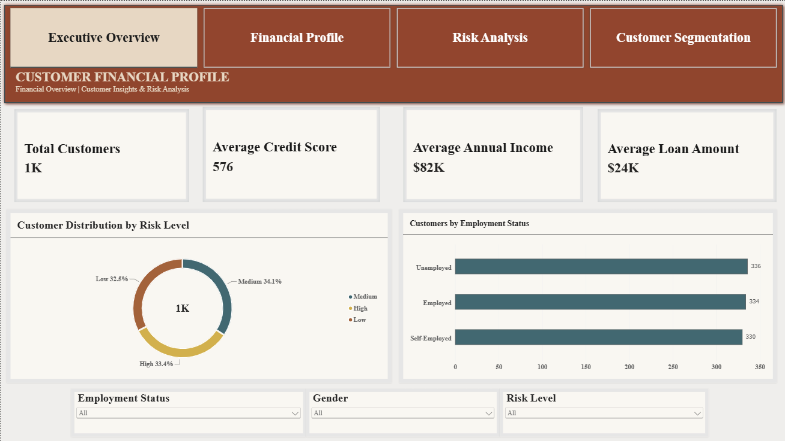
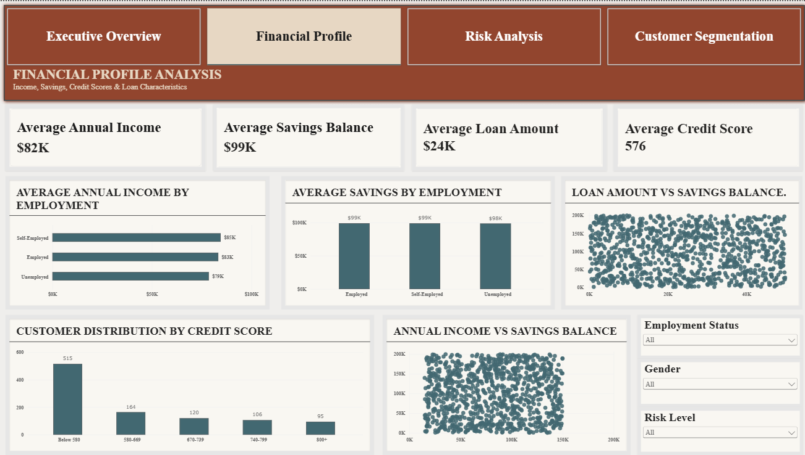
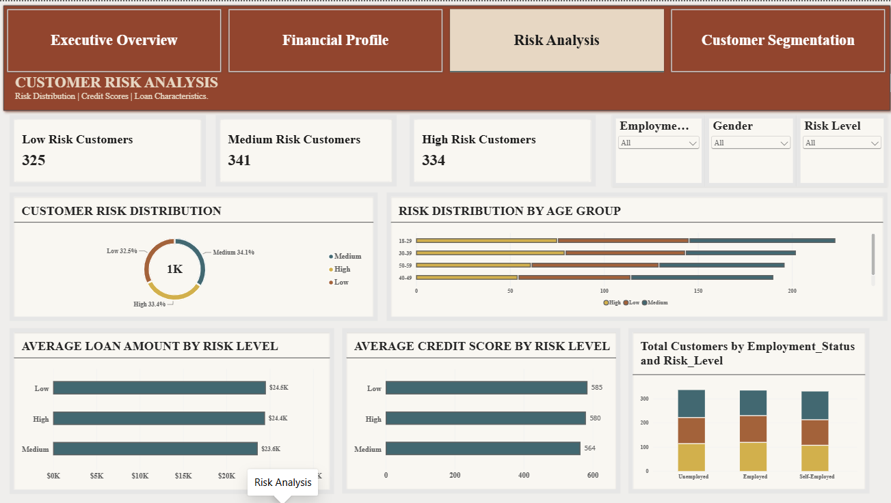
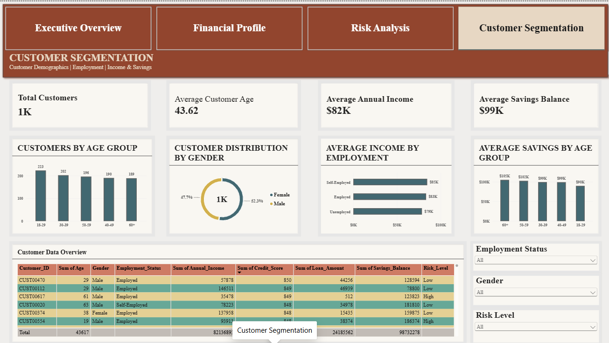

# 💳 Customer Financial Profile Analysis

### End-to-End Data Analytics Project | Python • SQL • Power BI

An end-to-end data analytics project analyzing customer demographics, annual income, credit scores, loan amounts, savings balances, employment categories, and supplied risk classifications using Python, SQL, and Power BI.

The project demonstrates a complete analytics workflow, from data inspection and cleaning to exploratory analysis, SQL business analysis, DAX development, interactive dashboards, and evidence-based recommendations.

**Core technologies:** Python · Pandas · NumPy · MySQL · Power BI · DAX · Jupyter Notebook · Git · GitHub

---

## 📌 Project Overview

Financial data can reveal useful patterns about customer demographics, income, savings, borrowing, and recorded risk classifications. However, reliable analysis requires consistent data preparation, validated calculations, and clear communication of results.

This project transforms a customer financial profile dataset into structured analytical outputs and an interactive four-page Power BI dashboard.

The analysis focuses on describing the supplied dataset, comparing customer groups, and identifying patterns that warrant further investigation. It does not attempt to establish causation or predict actual loan defaults.

## 🎯 Business Objectives

- Inspect dataset structure, data types, completeness, and consistency.
- Clean and validate customer records while preserving the original data.
- Analyze customer demographics and age-group distributions.
- Compare annual income across employment categories.
- Examine credit scores, loan amounts, and savings balances.
- Explore the distribution of supplied Low, Medium, and High risk classifications.
- Compare financial indicators across customer groups.
- Develop reusable Python analysis scripts and SQL business queries.
- Create DAX measures and interactive Power BI report pages.
- Validate key metrics across Python, SQL, and Power BI.
- Document findings, business implications, limitations, and recommendations.

## 🛠️ Tools & Technologies

| Technology | Application |
|---|---|
| Python | Data preparation, validation, and analysis |
| Pandas | Data manipulation and tabular analysis |
| NumPy | Numerical operations |
| Matplotlib | Data visualization |
| Seaborn | Statistical charts and exploratory visualization |
| Jupyter Notebook | Reproducible analytical workflow |
| MySQL | Business analysis and SQL aggregations |
| MySQL Workbench | Database setup and query execution |
| Power BI | Interactive dashboard development |
| DAX | KPI measures and calculations |
| Git | Version control |
| GitHub | Project hosting and portfolio presentation |
| Antigravity | Project development and file organization |

---

## 📊 Power BI Dashboard Showcase

The Power BI report contains four report pages with a consistent visual theme, KPI cards, charts, slicers, and navigation.

### 1. Executive Overview

Provides a high-level summary of the customer population and selected financial indicators.



**Key components**
- Total Customers
- Average Credit Score
- Average Annual Income
- Average Loan Amount
- Customer Distribution by Risk Level
- Customers by Employment Status
- Employment Status, Gender, and Risk Level slicers

**Purpose:** Give users a quick overview of the dataset and its customer composition.

### 2. Financial Profile

Explores financial indicators and compares selected metrics across employment categories.



**Key components**
- Average Annual Income
- Average Savings Balance
- Average Loan Amount
- Average Credit Score
- Average Income by Employment
- Average Savings by Employment
- Customer Distribution by Credit Score
- Loan Amount vs Savings Balance
- Annual Income vs Savings Balance

**Purpose:** Describe the financial characteristics of customers and examine relationships between recorded financial variables.

### 3. Risk Analysis

Examines the supplied risk categories and compares selected financial indicators across risk groups.



**Key components**
- Low Risk Customers
- Medium Risk Customers
- High Risk Customers
- Customer Risk Distribution
- Risk Distribution by Age Group
- Average Loan Amount by Risk Level
- Average Credit Score by Risk Level
- Customer Counts by Employment Status and Risk Level

**Purpose:** Understand the distribution of supplied risk classifications and identify group-level differences for further investigation.

### 4. Customer Segmentation

Compares customer demographics and financial indicators across age groups, gender, and employment categories.



**Key components**
- Total Customers
- Average Customer Age
- Average Annual Income
- Average Savings Balance
- Customers by Age Group
- Customer Distribution by Gender
- Average Income by Employment
- Average Savings by Age Group
- Customer Data Overview
- Interactive slicers

**Purpose:** Explore differences in customer composition and financial characteristics across selected segments.

**Power BI report file:** `powerbi/Customer_Financial_Profile_Analysis.pbix`

Open the PBIX file in Microsoft Power BI Desktop to explore the interactive report. The PNG files displayed above are static screenshots and do not contain interactive functionality.

---

## 🔍 Analytical Questions

### Customer Demographics
- How many customer records and unique customer IDs are present?
- How are customers distributed by gender?
- Which age groups contain the most customers?
- What is the average customer age?

### Income and Employment
- What are the average, minimum, and maximum annual incomes?
- Which employment category has the highest average annual income?
- How does income vary across employment categories?
- How does income differ across age groups?

### Savings and Loans
- What is the average savings balance?
- What is the average loan amount?
- How do savings balances vary across age groups?
- Is there an observable relationship between annual income and savings balance?
- How do loan amounts compare with savings balances?

### Credit Scores and Risk Classifications
- How are credit scores distributed?
- How many customers fall into each supplied risk category?
- What percentage of the dataset belongs to each risk category?
- How do average credit scores differ across supplied risk categories?
- How do risk classifications vary across employment categories?
- How do risk classifications vary across age groups?
- How do average loan amounts compare across risk categories?

---

## 🧹 Project Workflow

### Business Understanding
Defined the project objectives, business questions, scope, and analytical limitations.

### Dataset Understanding
Inspected dimensions, column names, data types, missing values, duplicate records, category distributions, and numeric summaries.

**Notebook:** `notebooks/01_dataset_understanding.ipynb`

### Data Cleaning
Validated customer identifiers, categorical fields, numeric columns, and output consistency. The workflow preserves the raw dataset and avoids unnecessary record removal.

**Notebook:** `notebooks/02_data_cleaning.ipynb`

**Reusable script:** `src/data_cleaning.py`

### Exploratory Data Analysis
Analyzed customer demographics, financial distributions, employment categories, risk classifications, and selected relationships between numerical variables.

**Notebook:** `notebooks/03_eda.ipynb`

**Outputs:** Summary tables in `reports/` and chart images in `visualizations/`.

### SQL Business Analysis
Created a MySQL schema and developed queries for customer summaries, financial metrics, risk analysis, grouping, ranking, and advanced comparisons.

**SQL files:** `sql/01_schema.sql` through `sql/04_advanced_analysis.sql`

### Power BI Data Modeling
Prepared the customer data model, validated fields and data types, and checked the model for appropriate relationships.

### DAX and Dashboard Development
Developed customer and financial KPI measures and built four report pages with charts, slicers, and page navigation.

### Insights and Recommendations
Documented descriptive findings, analytical limitations, and recommendations supported by the available evidence.

**Report:** `reports/business_insights.md`

---

## 📁 Repository Structure

```text
CUSTOMER_FINANCIAL_PROFILE_ANALYSIS/
├── data/
│   ├── raw/
│   └── processed/
├── docs/
│   ├── business_requirements.md
│   ├── business_questions.md
│   └── data_dictionary.md
├── notebooks/
│   ├── 01_dataset_understanding.ipynb
│   ├── 02_data_cleaning.ipynb
│   └── 03_eda.ipynb
├── powerbi/
│   ├── Customer_Financial_Profile_Analysis.pbix
│   └── Visualization_Output/
│       ├── 01_executive_overview.png
│       ├── 02_financial_profile.png
│       ├── 03_risk_analysis.png
│       └── 04_customer_segmentation.png
├── reports/
│   ├── business_insights.md
│   ├── data_cleaning_report.md
│   ├── dataset_inspection_report.md
│   ├── dataset_inspection_summary.csv
│   ├── eda_customer_summary.csv
│   ├── eda_financial_summary.csv
│   ├── eda_financials_by_employment.csv
│   ├── eda_financials_by_risk.csv
│   ├── eda_findings.md
│   ├── eda_risk_by_age_group.csv
│   ├── eda_risk_by_employment.csv
│   ├── script_customer_summary.csv
│   ├── script_employment_status_distribution.csv
│   ├── script_financials_by_employment.csv
│   ├── script_financials_by_risk.csv
│   ├── script_gender_distribution.csv
│   ├── script_numeric_correlation.csv
│   ├── script_risk_by_age_group.csv
│   ├── script_risk_by_employment.csv
│   ├── script_risk_level_distribution.csv
│   └── sql_validation_report.md
├── sql/
│   ├── 01_schema.sql
│   ├── 02_basic_analysis.sql
│   ├── 03_risk_analysis.sql
│   └── 04_advanced_analysis.sql
├── src/
│   ├── analysis.py
│   └── data_cleaning.py
├── visualizations/
├── .gitignore
├── README.md
└── requirements.txt
```

The structure above reflects the documented project files. Confirm it against the actual repository before publishing, especially any newly generated report files or additional visualizations.

---

## 📈 Key Findings

The initial dataset inspection reported **1,000 customer records and 9 columns**. The following figures are preliminary results from that inspection and should be reconciled with the final cleaned dataset and SQL outputs before publication.

| Metric | Initial inspected result |
|---|---:|
| Customer records | 1,000 |
| Average customer age | 43.62 years |
| Average annual income | 82,136.89 |
| Average credit score | 576.08 |
| Average loan amount | 24,185.56 |
| Average savings balance | 98,732.28 |
| Low risk customers | 325 |
| Medium risk customers | 341 |
| High risk customers | 334 |

### Income by Employment Category

Initial inspection results reported the following average annual incomes:

| Employment category | Average annual income |
|---|---:|
| Self-Employed | 84,546.04 |
| Employed | 83,348.16 |
| Unemployed | 78,566.71 |

In the inspected dataset, the Self-Employed category had the highest average annual income of the three categories.

These are descriptive comparisons. They do not establish why the differences occur or imply any causal relationship.

---

## 💡 Business Recommendations

### 1. Standardize Financial Reporting
Maintain consistent definitions for customer counts, annual income, savings balances, loan amounts, and credit scores across analytical tools.

### 2. Investigate Customer Group Differences
Use the dashboard to explore meaningful differences across age groups and employment categories, then validate those patterns before making decisions.

### 3. Review Risk Classification Definitions
Confirm how the supplied Low, Medium, and High risk labels were assigned before using them in operational decisions.

### 4. Maintain Data Quality
Preserve the raw dataset, document cleaning decisions, and repeat validation when the source data changes.

### 5. Validate Published Metrics
Reconcile Python, SQL, and Power BI calculations and document any discrepancies before publishing final findings.

### 6. Improve Future Analysis
If authorized and appropriate data becomes available, consider adding repayment history, default outcomes, or additional time-based records to support more detailed analysis. Such data should be handled under applicable privacy and security requirements.

---

## ✅ Data Quality and Validation

The project includes checks for:

- Missing values and exact duplicate records.
- Duplicate customer identifiers.
- Expected columns and categorical values.
- Numeric data types and validation ranges.
- Successful saving and reloading of the processed CSV.
- Customer counts and risk category distributions.
- Consistency between Python, SQL, and Power BI metrics.
- Correct use of dashboard filters and slicers.

The original dataset is retained separately from the processed dataset. Any unexpected data-quality issue should be investigated and documented rather than automatically deleting records.

## ⚠️ Dataset Limitations

- The dataset may not represent a broader customer population.
- The currency and source definitions for financial fields should be confirmed.
- Supplied risk classifications are not independently verified default probabilities.
- Observed relationships do not prove causation.
- The project is descriptive and does not constitute a validated credit-scoring or loan-default prediction model.
- Conclusions depend on the quality, scope, and provenance of the source dataset.

---

## 🧠 Skills Demonstrated

- Data cleaning and transformation
- Python and Pandas
- Exploratory data analysis
- SQL querying and aggregation
- Grouping, ranking, and analytical comparisons
- Data validation and quality checks
- Power BI data modeling
- DAX measure development
- Interactive dashboard design
- Business reporting and recommendations
- Git and GitHub version control

---

## 🚀 How to Run the Project

### Prerequisites
- Python 3.10 or a compatible version
- MySQL and MySQL Workbench
- Microsoft Power BI Desktop
- Git

### 1. Clone the repository

```bash
git clone https://github.com/rubankumar296-maker/CUSTOMER_FINANCIAL_PROFILE_ANALYSIS.git
cd CUSTOMER_FINANCIAL_PROFILE_ANALYSIS
```

Use the exact repository URL displayed on your GitHub page if it differs.

### 2. Create a virtual environment

```powershell
python -m venv .venv
.\.venv\Scripts\Activate.ps1
```

### 3. Install dependencies

```powershell
python -m pip install -r requirements.txt
```

### 4. Prepare the dataset

Place the authorized source CSV at:

`data/raw/Customer_Financial_Profile_Dataset.csv`

Confirm that this filename matches the path expected by the Python scripts.

### 5. Run data cleaning

```powershell
python src/data_cleaning.py
```

Review the validation output and confirm that the processed CSV is created successfully.

### 6. Run the analysis script

```powershell
python src/analysis.py
```

Review the exported summary tables in `reports/` and generated charts in `visualizations/`.

### 7. Run the Jupyter notebooks

Run the notebooks in order:

1. `01_dataset_understanding.ipynb`
2. `02_data_cleaning.ipynb`
3. `03_eda.ipynb`

### 8. Execute SQL analysis

Open the SQL files in MySQL Workbench and execute them in order. Verify the database, table names, column types, and data import before running the analysis queries.

### 9. Open Power BI

Open `powerbi/Customer_Financial_Profile_Analysis.pbix` in Microsoft Power BI Desktop. Configure the data source if the dataset is stored in a different location.

> The dataset is not necessarily included in the repository. Obtain it from an authorized source if needed. Never publish confidential customer financial information or credentials.

---

## 👨‍💻 Author

**Ruban Kumar N**

Aspiring Data Analyst | Python | SQL | Power BI

- GitHub: [rubankumar296-maker](https://github.com/rubankumar296-maker)
- Project Repository: [Customer Financial Profile Analysis](https://github.com/rubankumar296-maker/CUSTOMER_FINANCIAL_PROFILE_ANALYSIS)

This project is intended for learning and portfolio demonstration. All conclusions should be interpreted in the context of the source data and the limitations described above.